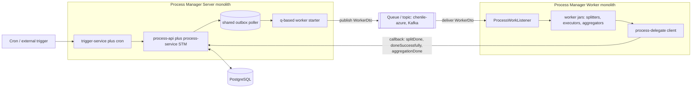
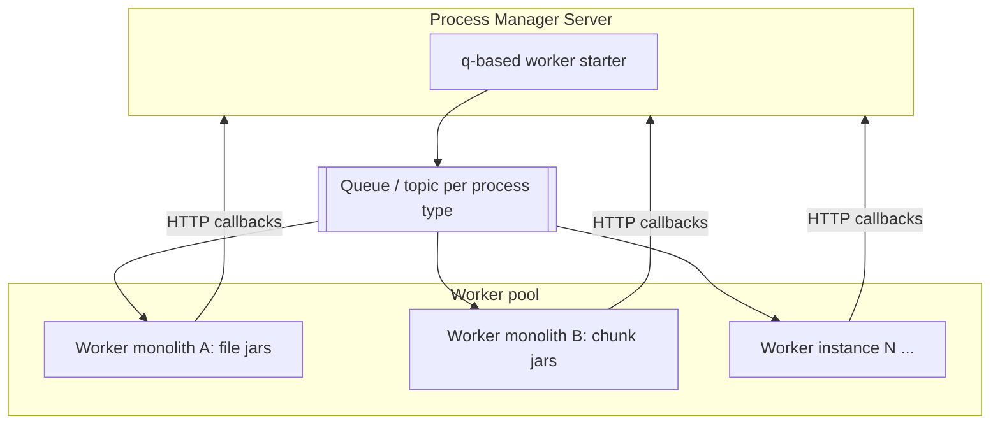

# Deploying Chenile Process Management

This document describes the **reference deployment topology** for Chenile Process
Management: how to run it in production as a small set of cooperating Chenile *mini
monoliths* rather than a single process. It is the basis for the companion
[presentation and video outline](deployment-presentation.md), and it is realised as
a reusable code generator in the [deployment blueprint](blueprints/process-deployment-blueprint.md).

For the runtime internals this topology assembles — the state machine, the always-on
durable outbox, the command registry, the three idempotency guards, triggers and the
data model — see the [process management guide](process-management.md) and the
[sequence and ER diagrams](process-management-diagrams.md).

## At a glance

A deployment consists of **at least two** mini monoliths, and can grow to include more:

1. **Process Manager Server** — the brain. It owns the state machine, the process
   database, the durable outbox, triggers and cron, and the management API. It
   *dispatches* work but does not perform it. Exactly one logical server (horizontally
   replicable).
2. **Process Manager Worker** — the muscle. It performs splitting, execution and
   aggregation, then reports results back to the server. Start with one; add more
   worker monoliths (and more worker instances) as load grows.

The two are decoupled by a **queue** (`chenile-azure`, Kafka, or any `chenile-pubsub`
transport). The server publishes a `WorkerDto` to a topic; a worker consumes it, does
the work, and calls back into the server over HTTP. Nothing but the queue and the
server's HTTP endpoint couples them, so workers scale independently of the brain.



The callback arrow is the key to the whole design: a worker never touches the process
database. It receives a self-describing `WorkerDto`, does its job, and raises an event
back into the server's state machine. All authoritative state stays on the server.

## Why split the server from the worker

The server and the worker have opposite operational profiles, and separating them lets
each be deployed and scaled on its own terms:

- **The server is stateful and singular in intent.** It holds the only writable copy
  of process state, runs the outbox poller, and must share one datasource and
  transaction manager across state, outbox and receipts. You replicate it for
  availability, not for throughput of business work.
- **The worker is stateless and plural.** It owns no process state; it holds only the
  code that does domain work. CPU-bound executors, memory-hungry aggregators and
  bursty splitters can each live in their own worker monolith, scaled (including to
  zero, with KEDA on the queue depth) without touching the brain.
- **Blast radius.** A crash, a redeploy, or a bad worker jar takes down work execution,
  not the orchestration record. The server keeps the durable outbox; undelivered work
  is redelivered when a worker returns.
- **Independent release cadence.** Worker domain logic changes far more often than the
  orchestration engine. Shipping a new executor is a worker deploy, not a server deploy.

## The Process Manager Server monolith

A Chenile mini monolith that packages the orchestration engine and everything that
*starts* work:

| Packaged module | Role in the server |
|---|---|
| `process-api` | model (`Process`, `ProcessDto`, `WorkerDto`, `WorkerType`), `WorkerStarter` contract, config abstraction |
| `process-service` | the STM (`PROCESS_FLOW`), `ProcessManagerImpl`, `ProcessEntryAction`, the controllers, the configurators, the management API |
| `chenile-outbox` | the always-on durable transactional outbox and its draining poller (`OutboxDispatcher`) |
| **one** `WorkerStarter` — preferably `q-based-process-starter` | turns a `START_WORKER` command into a message on the queue |
| `trigger-api` plus `trigger-service` | durable acceptance, status queries and DISPATCH_TRIGGER outbox delivery |
| `crontab-api` | shared schedule model and external contracts |
| `crontab-service` | durable Quartz crontabs (`chenile_crontab`) that fire activations |
| `process-ui` (optional) | the React admin console behind the management API |

What the server does:

- **Receives triggers.** A crontab row fires in Quartz, or an external adapter posts an
  activation. Either way it reaches `TriggerService.trigger(TriggerInput)`, which claims
  submission idempotency in the outbox and returns the outbox ID. Later, the dispatcher raises
  the ProcessCreate event using that ID as x-chenile-trigger-id.
- **Creates and advances processes.** `ProcessManagerImpl.create(ProcessDto)` persists a
  root `Process` and drives it through the STM. Every transition records its consequences
  as rows in `chenile_process_outbox` **in the same transaction that saves the process**.
- **Dispatches work.** The outbox poller drains due commands. A `START_WORKER` command
  hands a `WorkerDto` to the configured `WorkerStarter`. With the queue-based starter,
  `QueueBasedProcessStarter.start(workerDto)` serialises the `WorkerDto` to JSON and calls
  `ChenilePub.asyncPublish(topic, json, props)`, where `topic` comes from the process
  definition's `execDef.get("queue")` and `props` carries the tenant as `x-chenile-tenant-id`.
- **Receives callbacks.** It exposes the `ProcessManager` service over HTTP under the
  Chenile service name `processService`. Workers call back into `PATCH /process/{id}/{event}`
  (via a proxy) to report `splitDone`, `doneSuccessfully`, `aggregationDone`, and the
  error variants.
- **Chains and completes.** On a terminal state `EMIT_COMPLETED` publishes `ProcessCompleted`;
  the framework-chaining subscriber creates any configured successor processes.

Why the **q-based** starter is preferred for this topology: it is the one that physically
decouples the server from the worker. The in-VM starter runs workers inside the server
(no separate worker monolith); the JDBC starter keeps a durable work queue in the database
(workers must share that database). The queue starter needs nothing shared but a broker,
which is exactly what a stateless remote worker wants.

### Server configuration (essentials)

```properties
# Definitions and durable outbox
chenile.process.configurator=database          # or json
chenile.process.outbox.run-dispatcher=true     # this instance drains the outbox
chenile.process.outbox.poll-interval-millis=1000

# Management API (admin console / ops)
chenile.process.management.enabled=true
chenile.process.management.api-key=${PROCESS_MANAGEMENT_API_KEY}   # >= 32 chars

# PostgreSQL: state, outbox, receipts and crontab all share ONE datasource
spring.datasource.url=jdbc:postgresql://db:5432/process
```

The queue/topic names are not a single server property — each process type names its
own topic through the definition's `config` / `execDef` map (`"queue": "..."`), so
different process types can be routed to different worker pools.

## The Process Manager Worker monolith

A Chenile mini monolith that packages only what *performs* work. It holds no process
state and needs no process database.

| Packaged module | Role in the worker |
|---|---|
| `process-delegate` | `ProcessManagerClient` plus `DelegateConfiguration`, which builds the `processServiceProxy` pointed at the server; also the worker base classes (`SplitterBase`, `ExecutorBase`, `AggregatorBase`, `BatchServiceBase`) |
| one or more **worker jars** | your domain code: concrete splitters, executors and aggregators, each extending the base classes |
| a **`ProcessWorkListener`** | the controller that receives a `WorkerDto` off the queue and invokes the matching worker; it must be instantiated by this monolith |
| a `chenile-pubsub` **subscriber** | bound to the same topic the server's starter publishes to (`chenile-azure`, Kafka, etc.) |

What the worker does:

- **Subscribes to the queue.** A `chenile-pubsub` subscriber (e.g. `chenile-azure`) listens
  on the topic the server publishes `WorkerDto`s to. Delivery surfaces the `WorkerDto` as
  the body of the worker-dispatch Chenile event.
- **Dispatches to the right worker.** `ProcessWorkListener` is a `@ChenileController`
  subscribed (`@EventsSubscribedTo`) to that event with a `@ChenileBody WorkerDto`. It
  resolves the correct `IWorker` for the `workerType` (`SPLITTER` / `EXECUTOR` / `AGGREGATOR`)
  and `processType`, and calls `worker.start(workerDto, input)`.
- **Performs the work.** Each worker extends a base class from `process-delegate`:
  - `SplitterBase.doStart(...)` returns a list of `SubProcessPayload`s (the children).
  - `ExecutorBase.doStart(...)` converts input to output.
  - `AggregatorBase.doStart(...)` folds each child's output into a consolidated output
    (it pulls children via `processManagerClient.getSubProcesses(...)`).
- **Reports back.** The base classes call `processManagerClient.splitDone(...)`,
  `doneSuccessfully(...)` or `aggregationDone(...)` on success, and the matching
  `...WithErrors` variant on exception. Those calls go through the `processServiceProxy`
  over HTTP to the server, which applies the event to the STM.

The one piece of wiring that makes a worker monolith a *worker*: it must be started with
the **location of the process manager server**. `DelegateConfiguration` reads
`process.manager.base-url` and builds the Chenile proxy from it. Without it the worker
cannot report results.

### Worker configuration (essentials)

```properties
# Where the brain lives — REQUIRED. Every result callback goes here.
process.manager.base-url=http://process-manager-server:8080

# Subscribe to the same topic the server's q-based starter publishes to
chenile.pubsub.<transport>.subscriptions.process-work.topic=process-work
# ...transport (chenile-azure / Kafka) connection settings
```

A worker needs **no** `spring.datasource` for process state and does **not** run the
outbox poller — those belong to the server.

## The dispatch and callback loop

This is the complete life of one unit of work, end to end across the two monoliths.

```mermaid
sequenceDiagram
    autonumber
    participant Cron
    participant Trig as TriggerService
    participant PM as ProcessManager STM
    participant Out as Outbox poller
    participant Q as Queue
    participant WL as ProcessWorkListener
    participant Wk as Worker

    Note over Cron,Out: Process Manager Server monolith
    Note over WL,Wk: Process Manager Worker monolith

    Cron->>Trig: Quartz fires, submit TriggerInput with idempotencyKey
    Note over Trig: commits DISPATCH_TRIGGER, acknowledges its outbox ID
    Trig->>Out: persist DISPATCH_TRIGGER; return ID
    Out->>PM: later dispatch ProcessCreate using command ID
    PM->>PM: persist root Process, enter STM
    PM->>Out: record START_WORKER in outbox (same tx)
    Out->>Q: publish WorkerDto (q-based starter, ChenilePub)
    Q->>WL: deliver WorkerDto (chenile-pubsub subscriber)
    WL->>Wk: resolve IWorker by workerType, start(workerDto, input)
    Wk->>Wk: doStart(...) performs the real work
    Wk-->>PM: HTTP callback splitDone / doneSuccessfully / aggregationDone
    PM->>PM: apply event, advance STM
    PM->>Out: record next consequences (create children, signal parent, start next worker)
    Note over PM,Out: loop continues until a terminal state
    PM->>PM: terminal, EMIT_COMPLETED publishes ProcessCompleted, successors chained
```

Two properties worth calling out, both inherited from the engine and unchanged by this
topology:

- **The queue hop is at-least-once.** A `WorkerDto` can be delivered more than once. The
  callbacks are made safe by the server's effect-level idempotency (`checkIdempotency` on
  `chenile_process_receipt`, keyed by business identity), so a replayed worker cannot
  double-count a child or create duplicate successors. Workers should still avoid
  irreversible external side effects without their own dedup.
- **Creation returns before completion.** The server returns from `create` once the root is
  committed and its first command is enqueued — not when the cascade finishes. Progress is
  observed through the management API, not a synchronous response.

## Scaling to more workers



Three independent axes of growth:

- **More instances of one worker monolith.** Run N replicas against the same topic; the
  broker's competing-consumer semantics spread `WorkerDto`s across them. KEDA can scale
  the replica count (even to zero) on queue depth.
- **More worker monoliths.** Because each process type names its own topic in its
  definition, you can route heavy process types to their own worker pool with its own
  jars, resource limits and scaling policy, while light ones share another.
- **More worker jars inside a monolith.** A single worker monolith can package several
  worker jars; the `ProcessWorkListener` resolves the right `IWorker` per `WorkerDto`, so
  co-locating related splitters/executors/aggregators is just a packaging choice.

The server stays single in intent throughout. Replicate it for availability (each replica
can run the poller and competes for outbox rows through `FOR UPDATE SKIP LOCKED`), but you
do not scale the server to get more business throughput — you scale the workers.

## Generating the topology

Both monoliths are mechanical to assemble: the module sets are fixed, only the worker jars
and the process definitions vary. That is exactly what a generator is for. The
[process-deployment blueprint](blueprints/process-deployment-blueprint.md) is a
`chenile-gen` blueprint that scaffolds a runnable **server** monolith and one or more
runnable **worker** monoliths from a single spec — wiring the module manifests, the
`ProcessWorkListener`, the queue subscriptions and `process.manager.base-url` for you. It
builds on the existing `chenile-process-management` and `minimonolith` blueprints; see the
blueprint document for its input contract and generated layout.

## Operational checklist

- Server and worker are separate deployables; only the server owns the PostgreSQL
  datasource and runs the outbox poller.
- Give the queue transport (`chenile-azure` / Kafka) a dead-letter path of its own; it is
  orthogonal to the outbox's `DEAD` handling on the server.
- The worker's `process.manager.base-url` must be reachable from every worker instance;
  put the server behind a stable address or gateway.
- The management API key administers all tenants — serve the management API and UI over
  HTTPS behind an admin gateway, never from a worker.
- Keep each process type's `queue` name in its definition aligned with a real subscription
  on the intended worker pool; an unrouted topic silently strands work on the broker.
