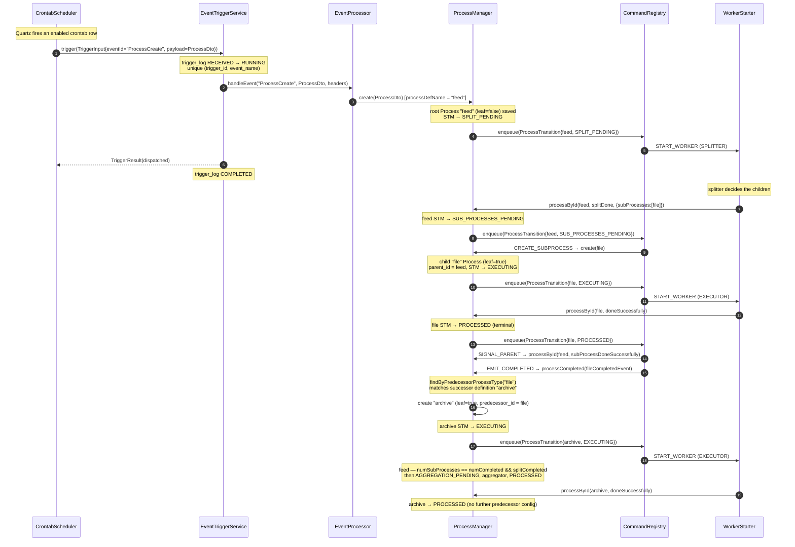
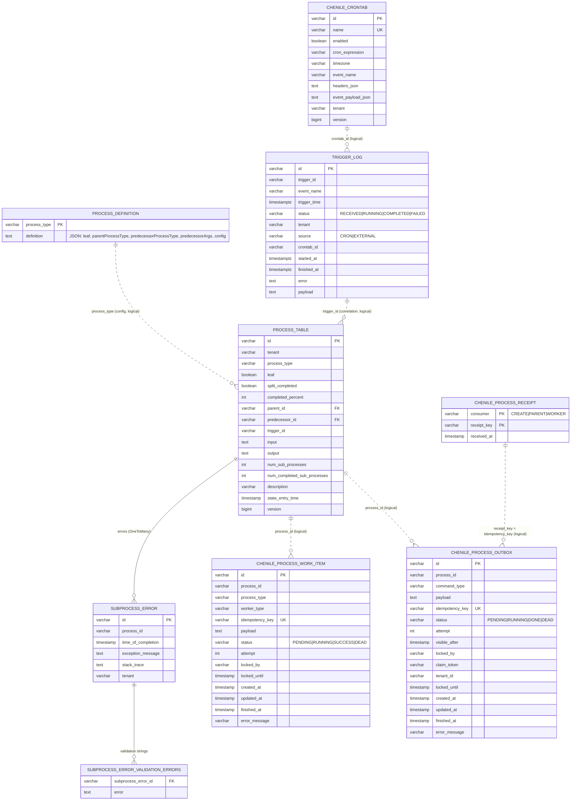

# Chenile Process Management — Diagrams

These diagrams reflect the current code (unified `trigger_log`; no `chenile_trigger_execution` or
`chenile_process_completion_event` tables; pluggable outbox command registry). They supersede the older
sketches under `docs/puml/`.

## 1. Sequence: cron → trigger → root process → splitter → leaf child → chained successor

Scenario: a Quartz crontab fires `ProcessCreate`. The created root process is **non-leaf**, so its splitter
runs and creates a **leaf** child. When that leaf child completes it chains a **new leaf process** that
names the leaf child as its predecessor in configuration (`predecessorProcessType`), so the successor is
created with `predecessor_id` set to the leaf child.

Participants: **Cron** = `CrontabScheduler` (crontab-trigger); **Trig** = `EventTriggerService`
(trigger-service); **EP** = `EventProcessor`; **PM** = `ProcessManager` (STM, process-service); **Reg** =
`ProcessEntryAction` + the outbox command registry (process-outbox); **W** = `WorkerStarter`
(splitter / executor).

Notes:

- **Durable delivery.** Each `Reg -> …` command is an `OutboxCommandLifecycle`, recorded in
  `chenile_process_outbox` **in the same transaction that saves the process**. The dispatcher executes it
  after commit, so the arrows above express logical order rather than synchronous execution.
  Non-durable/inline delivery has been removed. `EMIT_COMPLETED` reaches the manager through its
  registered `ProcessCompleted` subscriber, not a direct call.
- **Idempotency on the chaining edge.** `EMIT_COMPLETED` dispatch records a `CHAIN` receipt keyed by
  `[predecessorId, successorType]`, and `SIGNAL_PARENT` records a `PARENT` receipt keyed by
  `[parentId, childId]`, so a redelivered completion neither creates duplicate successors nor double-counts
  the parent.
- The successor (`archive`) is itself a leaf, so it executes and completes; it chains no further unless some
  definition names `archive` as *its* `predecessorProcessType`.

## 2. Entity-relationship diagram

Solid lines are relationships Hibernate enforces (foreign keys / join tables). Dashed lines are **logical**
references by id that the code follows but does not enforce as database foreign keys. Base-class columns
(`id`, `tenant`, created/modified timestamps, `version`, and — for `process_table` — the STM state and
`state_entry_time`) are abbreviated.

`process_table` references itself twice: `parent_id` points at the parent process (sub-process tree) and
`predecessor_id` points at the process this one was chained from (successor lineage). Both appear as `FK`
attributes below; Mermaid's `erDiagram` cannot draw an entity related to itself, so they are not drawn as
relationship lines.

### Table descriptions

- **`process_table`** (entity `Process`) — the heart of the system: one row per process in the tree, holding
  its type, STM state, split/aggregation counters, serialized `input`/`output`, and the self-references
  `parent_id` (sub-process tree) and `predecessor_id` (successor lineage). Every running job is a subtree of
  these rows.
- **`subprocess_error`** (entity `SubProcessError`) — error detail for a process that failed: one critical
  exception message and stack trace per row, linked from `process_table` via a Hibernate join table. The bulk
  of validation messages live in its child table below.
- **`subprocess_error_validation_errors`** — the `@ElementCollection` of row-level validation strings for a
  `SubProcessError`. Keeps the many small "row N was malformed" messages out of the main error row.
- **`process_definition`** (entity `ProcessDefinition`) — the database-backed process catalogue used when
  `chenile.process.configurator=database`: one row per process type, storing the `ProcessDef` as JSON (leaf
  flag, parent/predecessor relationships, worker `config`). Editable at runtime via the management API.
- **`chenile_process_work_item`** — the JDBC worker queue (jdbc-process-starter). Each row is a unit of work
  claimed by a worker with `FOR UPDATE SKIP LOCKED`, leased, retried, and finally `SUCCESS` or `DEAD`. This is
  the KEDA-scalable backlog for distributing worker execution.
- **`chenile_process_outbox`** — the transactional outbox. Each row is one durable consequence of a transition
  (a command), written in the same transaction that saves the process and later drained by the dispatcher. It
  carries the registry `command_type`, serialized payload, the unique `idempotency_key` (enqueue de-dup),
  `claim_token` + lease (fencing), and `visible_after` (backoff/scheduling).
- **`chenile_process_receipt`** — the effect-level idempotency ledger. One row per `(consumer, receipt_key)`
  business fact, inserted in the same transaction as the effect so a redelivered command is a no-op. This is
  what makes parent counting and successor chaining exactly-once across retries and replays.
- **`trigger_log`** (entity `TriggerLog`, trigger-service) — one row per accepted trigger, serving double duty:
  the unique `(trigger_id, event_name)` claim that makes dispatch idempotent, plus the dispatch history
  (status `RECEIVED` → `RUNNING` → `COMPLETED`/`FAILED`, source, timings, payload, error). It is what the
  management API's execution view reads.
- **`chenile_crontab`** (entity `Crontab`, crontab-trigger) — durable Quartz schedules: one row per cron,
  holding the expression, timezone, the event to fire (`ProcessCreate`), and its headers/payload JSON. Saving
  or deleting a row registers or removes the Quartz job.

`CHENILE_PROCESS_RECEIPT` has no relationships by design — it is the effect-level idempotency ledger
(`checkIdempotency(consumer, key)`), keyed by business identity (e.g. `PARENT` → `[parentId, childId]`,
`CHAIN` → `[predecessorId, successorType]`), not by a foreign key.

The three idempotency guards map onto columns here: enqueue de-duplication is `CHENILE_PROCESS_OUTBOX.idempotency_key`
(unique), claim-token fencing is `CHENILE_PROCESS_OUTBOX.claim_token` + `locked_until`, and effect-level
exactly-once is `CHENILE_PROCESS_RECEIPT`.

### Why `chenile_process_receipt` is a separate table (not folded into the outbox)

The outbox row already has a unique `idempotency_key` and a `status`, so it is tempting to reuse it as the
idempotency check. It cannot serve that role: the outbox row and the receipt answer two different questions,
and only the receipt answers "has this *effect* already been applied, exactly once, across every redelivery,
retry and operator replay?" The reasons:

- **Per-row key vs per-business-fact key.** `idempotency_key` identifies *one consequence of one transition*
  (one row). A receipt key identifies a *business fact* that several distinct rows can produce. `SIGNAL_PARENT`
  keys on `[parentId, childId]` and deliberately **excludes the event name**, so a `subProcessDoneSuccessfully`
  and a `subProcessDoneWithErrors` command for the same child — two rows with two different `idempotency_key`s
  — are recognised as "this child completed once" and counted once. `CHAIN` keys on
  `[predecessorId, successorType]` so a successor is created once regardless of which completion row drove it.
  The per-row outbox key cannot express this cross-row identity.
- **Enqueue-dedup is not effect-applied-once.** `idempotency_key` prevents a duplicate *enqueue* (producer
  side); it says nothing about how many times a row is *executed* (consumer side). A single row legitimately
  executes more than once — crash retry, lease-expiry reclaim, and especially `replayDead`.
- **Replay conflicts with using the row's status.** "Skip if the row is `DONE`" breaks `replayDead(id)`, which
  intentionally resets the row to `PENDING, attempt=0` to run it again. If the row's status were the marker,
  replay would re-apply a committed effect (e.g. create a second successor with a fresh id, or re-increment
  the parent counter). The receipt — written in the same transaction as the effect and the ack — lets the row
  re-run while the committed effect is skipped, decoupling *delivery attempts of the row* from *the effect
  happening once*.
- **Independent retention.** The outbox is a work queue whose `DONE` rows are meant to be pruned/archived; the
  idempotency fact must survive for the whole window a duplicate or replay could still arrive, which is longer
  than and independent of the queue entry. If the outbox row *were* the idempotency record, you could never
  delete a completed row without losing the guarantee.

Folding this into the outbox via a business-keyed column/constraint would force every completed row to be
retained forever, require per-consumer key shapes in one column, and still need replay special-cased against
its own constraint — i.e. it rebuilds the receipt table inside the outbox with worse ergonomics.
