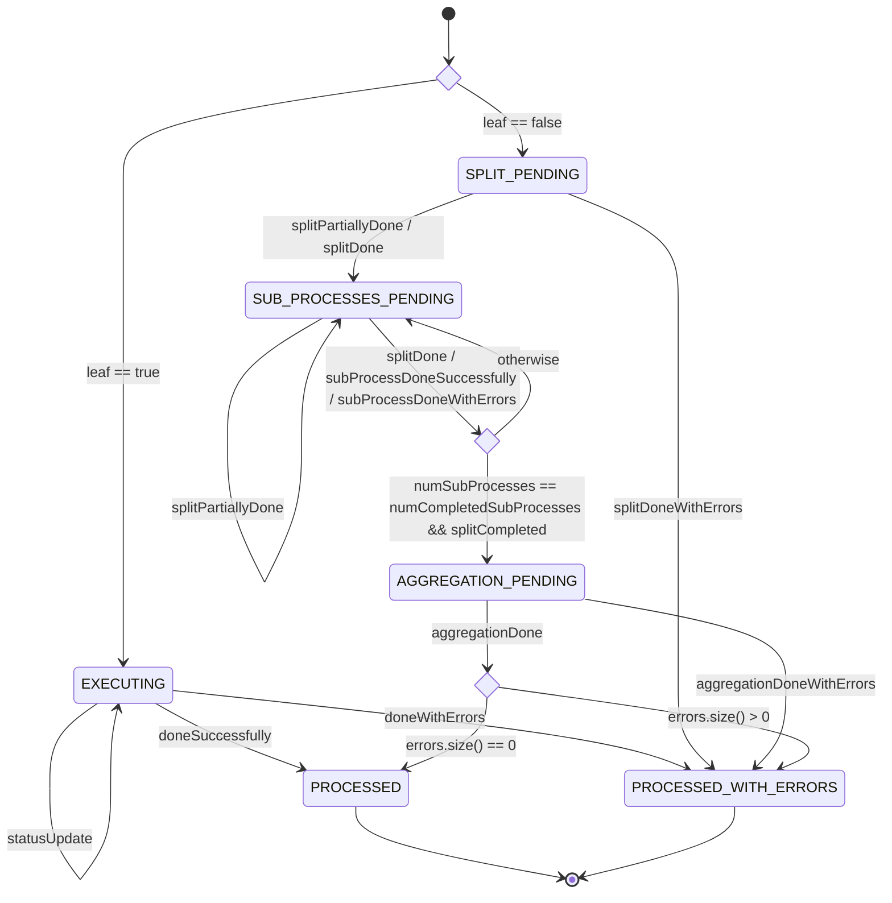

# Chenile Process Management — Guide

Chenile Process Management is a splitter/aggregator (map-reduce) orchestrator built on Chenile's
state-machine (STM) framework. A long-running job is modelled as a tree of `Process` entities: a
non-leaf process splits into sub-processes, each sub-process may split further, leaf processes execute
real work, and results aggregate back up the tree until the root is complete. The flow is declared once
in a state-transition file; the work itself is performed by pluggable workers that run outside the state
machine and report back into it by raising events.

The system is activated through triggers, drives each process through the state machine, launches the
right worker at each step, and emits an event when a process finishes so that downstream processes can be
chained. It runs as a library inside your own Spring application, backed by your own database.

## At a glance

Chenile Process Management orchestrates tree-structured, long-running jobs as data rather than as
procedural code. A trigger raises a `ProcessCreate` event that creates a root `Process`; the state machine
then drives each process according to its type — a leaf process executes directly, a non-leaf process
splits into children, waits for all of them, and aggregates — until it reaches a terminal state
(`PROCESSED` or `PROCESSED_WITH_ERRORS`). Work at each step is performed by a worker (splitter, executor,
or aggregator) that runs outside the machine and reports back by raising events. When a process finishes it
emits a `ProcessCompletedEvent`, from which configured successor processes are created, allowing processes
to be composed in sequence.

The moving parts: **process definitions** describe each type and its worker configuration, sourced from a
JSON file or a database table; **workers** run in one of three interchangeable modes — in-VM, a pub/sub
queue, or a durable JDBC work queue; **triggers** (durable Quartz crontabs, deduplicated through
`DISPATCH_TRIGGER` outbox commands) activate the system; and **tenancy** is carried from a framework header through the whole
tree. So that every consequence of a transition survives a crash, a **transactional outbox** — always on,
not a mode you turn on — writes each consequence in the same transaction as the state save and executes it
through a dispatcher with at-least-once delivery, consumer-receipt idempotency, lease-fenced claiming,
retry/backoff, dead-letter handling with compensation, and a reference target of PostgreSQL. Everything —
state, definitions, outbox, receipts, and trigger idempotency — lives in the application's own database.

> **Diagrams:** see [process-management-diagrams.md](process-management-diagrams.md) for a sequence diagram
> (cron → trigger → root process → splitter → leaf child → chained successor) and an entity-relationship
> diagram of the data model.

## Modules

The Maven reactor is organised into focused modules.

`process-api` holds the shared model — `Process`, `ProcessDto`, `WorkerDto`, `WorkerType`, the
`Constants` catalogue of states and events, the payload classes, and `ProcessCompletedEvent` — together
with the `WorkerStarter` interface and the configuration abstraction (`IProcessConfigurator`,
`ProcessDef`).

`process-service` is the running service: the STM definition, the transition-action commands,
`ProcessManagerImpl`, `ProcessController`, `ProcessEntryAction`, `StartWorkerCommand`, the configurators, the
durable-execution wiring, and the Spring configuration.

`process-delegate` provides the remote manager client together with the worker APIs, base classes
(`SplitterBase`, `ExecutorBase`, `AggregatorBase`, orchestrated by `BatchServiceBase`) and helpers.
The former `process-utils` module has been merged into this artifact. Existing Java packages under
`org.chenile.orchestrator.process.utils` and `org.chenile.orchestrator.delegate` are unchanged.

`chenile-outbox` is the transactional outbox infrastructure used for durable execution (see below). It is
independent of process APIs and uses Chenile core context for transaction-scoped handler execution.

`invm-process-starter`, `q-based-process-starter`, and `jdbc-process-starter` are the three
interchangeable worker launch strategies.

`trigger-api` contains trigger contracts and input/result DTOs, including response metadata from chenile-base.
`trigger-service` supplies in-JVM event dispatch, trigger idempotency and execution history.
`crontab-api` owns crontab models and external service/reader contracts.
`crontab-service` implements durable Quartz crontabs (via `chenile-scheduler`) and depends on `trigger-api`, not
the trigger implementation. Schedules are read through a `CrontabReader` abstraction with two backends —
database (`CrontabRepository`) and JSON (`JsonCrontabRepository`) — and validated by `CrontabValidator`.
Its events include `ProcessCreate`, which starts a root process. The two implementation dependencies
(`trigger-service`, `crontab-service`) are optional in `process-service`; applications select them
explicitly.

`process-admin-server` is a runnable Spring Boot host that bundles the process controllers, the trigger and
crontab modules, the JDBC worker starter, the management API, and the scheduler into one deployable
administration server. `process-ui` is a React + Vite administrator console that consumes the management API.
Both are described under "Management API and the admin console" below.

## The domain model

A `Process` carries the fields that drive orchestration: `leaf` (whether it executes directly or splits),
`processType`, `parentId`, `predecessorId`, `triggerId` (correlation to the activation that
created it), the transient `subProcesses` list used during a split, `splitCompleted`, the counters
`numSubProcesses` and `numCompletedSubProcesses`, `input` and `output` (serialized arguments and result),
an `errors` collection, and the inherited `tenant` from the framework base entity. The current STM state
lives on the entity as well.

## The state machine

The flow is defined in `process-service/src/main/resources/org/chenile/orchestrator/process/process-states.xml`.
States and event names are catalogued in `Constants`.



A new process starts at `isThisLeafNode`, which routes a leaf directly to `EXECUTING` and a non-leaf
to `SPLIT_PENDING`. Processes are created when triggered or when their predecessor completes;
there is no parked state or separate activation event.

A leaf process in `EXECUTING` runs its executor and reports `doneSuccessfully` (→ `PROCESSED`) or
`doneWithErrors` (→ `PROCESSED_WITH_ERRORS`); `statusUpdate` is a self-transition for progress reporting.

A non-leaf process in `SPLIT_PENDING` runs its splitter, which may emit `splitPartiallyDone` repeatedly as
it discovers children and finally `splitDone`; both land the process in `SUB_PROCESSES_PENDING`.

`SUB_PROCESSES_PENDING` is the coordination hub. Each child completion and the final `splitDone` route
through the decision `areAllSubProcessesDone`, whose guard —
`(numSubProcesses == numCompletedSubProcesses) && splitCompleted` — advances the process to
`AGGREGATION_PENDING` only when the split is finalized **and** every child has reported back. Requiring
both halves is what makes streaming/partial splits safe: children may begin finishing before the split is
declared complete without the parent deciding prematurely that it is done.

`AGGREGATION_PENDING` runs the aggregator, which emits `aggregationDone` (→ the `areThereErrors` decision,
which routes to `PROCESSED` or `PROCESSED_WITH_ERRORS` based on the accumulated errors) or
`aggregationDoneWithErrors` (→ `PROCESSED_WITH_ERRORS`). Both `PROCESSED` and `PROCESSED_WITH_ERRORS` are
terminal.

## End-to-end lifecycle

```
Trigger (Quartz crontab, or any adapter)
  → TriggerService.trigger(TriggerInput)         [idempotent on (triggerId, eventId)]
  → EventProcessor.handleEvent("ProcessCreate", ProcessDto, headers)
  → ProcessManagerImpl.create(ProcessDto)         [creates a root; retains trigger correlation]
  → root Process persisted, state machine entered
  → the matching SPLITTER / EXECUTOR / AGGREGATOR worker is launched
  → workers raise events (splitDone, subProcessDoneSuccessfully, aggregationDone, …) back into the STM
  → children created, parents notified, state advances
  → terminal state (PROCESSED / PROCESSED_WITH_ERRORS)
  → ProcessCompleted event emitted → successors chained as new processes
```

## Creating a process

Process creation is an event-driven operation. `ProcessController.create` is annotated
`@EventsSubscribedTo("ProcessCreate")`, so the same operation is reachable through `POST /process` or the
in-JVM `ProcessCreate` event. The request body is a `ProcessDto`:

```json
{ "processDefName": "feed", "args": { "file": "s3://…" }, "triggerId": "crontab:nightly:abc", "description": "Nightly feed" }
```

`ProcessManagerImpl.create(ProcessDto)` requires `processDefName`, serializes `args` into the process
`input`, records the `triggerId` (taken from the payload, or from the `x-chenile-trigger-id` context
header when the payload omits it) for correlation, and drives the new root through the state machine.

`triggerId` on a process is correlation metadata. A direct `POST /process` or a direct `create(ProcessDto)`
call always creates a new root; deduplication of repeated activations is the responsibility of the trigger
layer (described below), not the process manager.

Other controller endpoints: `GET /process/{id}` retrieves a process; `PATCH /process/{id}/{eventID}`
delivers an STM event with a typed payload; `GET /processChildren/{id}` returns the sub-process tree; and
`POST /process/completed` (`@EventsSubscribedTo("ProcessCompleted")`) is the ingress for completion-driven
chaining.

## Workers and launch modes

Each work-pending state has a corresponding worker. `StartWorkerCommand` resolves the worker type and its
configuration for the current state and hands a `WorkerDto` to the configured `WorkerStarter`:

| State | Worker | Configuration |
|---|---|---|
| `SPLIT_PENDING` | `SPLITTER` | `ProcessDef.config` |
| `EXECUTING` | `EXECUTOR` | `ProcessDef.config` |
| `AGGREGATION_PENDING` | `AGGREGATOR` | `ProcessDef.config` |

Every worker type for a process receives the same `config` map from the process definition (copied, never
mutated). Worker preparation happens at enqueue time, so durable commands retain their original
configuration snapshot. `StartWorkerCommand` resolves the application's `WorkerStarter` lazily at dispatch;
dispatch without a starter fails and retries.
Starter configurations expose beans directly; they no longer inject or mutate a `PostSaveHook` bean.
Applications previously calling `postSaveHook.setWorkerStarter(...)` must instead supply a `WorkerStarter`
bean. With multiple candidates, select one using `@Primary`; otherwise resolution fails as ambiguous.
Three interchangeable `WorkerStarter` implementations decide where work actually runs:

- **in-VM** dispatches the `WorkerDto` to the in-JVM `EventProcessor` — simplest, good for tests and small
  flows.
- **queue-based** publishes to a Chenile pub/sub topic named in the `execDef`, forwarding the tenant as
  `x-chenile-tenant-id` when present.
- **JDBC** inserts a durable `chenile_process_work_item` row (idempotency key, `FOR UPDATE SKIP LOCKED`
  claim, lease, attempt/retry, `DEAD` after the maximum attempts); a runner polls and executes. This is
  the production-grade, KEDA-scalable option.

Workers extend the `process-delegate` base classes, which handle payload typing, tenant propagation into the
Chenile context, and error reporting back to the daemon.

## Process definitions

A process definition (`ProcessDef`) describes a `processType`: whether it is a `leaf`, its
`parentProcessType`, its predecessor relationship for chaining (`predecessorProcessType`,
`predecessorArgs`), and a single `config` map shared by all of its worker types. Definitions are resolved
through `IProcessConfigurator.findByName`, with the source selected by property:

- `chenile.process.configurator=json` (default) — read from a JSON resource (`def.json`).
- `chenile.process.configurator=database` — read from the `process_definition` table, deserializing the
  stored JSON into `ProcessDef` on each lookup. This allows definitions to be managed at runtime without
  redeploying.

## Durable execution (transactional outbox)

Process Management requires a transactional outbox. Every transition saves its state and records its
consequences atomically. `ProcessEntryAction` never executes effects inline; each consequence is a row in
`chenile_process_outbox` **in the same database transaction that saves the `Process`**, and a dispatcher
drains and executes them. State change and its scheduled consequences therefore commit atomically or not at
all.

The consequences of a transition are modelled as a **registry of commands**, not a fixed switch. Each
command implements `OutboxCommandLifecycle<ProcessTransition>` — `type()` (a stable string discriminator),
`enqueue(transition)`, `dispatch(command)`, and an optional `onDead(command)` — and is registered as an
ordered Spring bean in `OutboxCommandRegistry` (via `ProcessCommandConfiguration`). `ProcessEntryAction`
saves the process and then calls `registry.enqueue(new ProcessTransition(process, toState))`; the registry
invokes every command's `enqueue` in registration order, and each command decides for itself whether it
applies to this transition (terminal state, work-pending state, newly created children, a parent to notify).
When a command is later drained, the dispatcher resolves its stored `command_type` back to the command with
`registry.resolve(type)`. Adding a new consequence is therefore just registering another bean — no enum,
switch, or schema change.

`AbstractProcessOutboxCommand` is the shared base: `store(...)` records a JSON snapshot, and dispatch
reads that snapshot after the originating transition commits. It scopes/restores tenant context around
`dispatch`/`onDead` and provides the transactional consumer-receipt helper. Process calls return the
committed transition state; workers and successor cascades complete separately.

Four commands ship by default, covering the consequences of a transition:

| Command (`type()`) | Effect |
|---|---|
| `CREATE_SUBPROCESS` | create a child process |
| `SIGNAL_PARENT` | deliver `subProcessDoneSuccessfully` / `subProcessDoneWithErrors` to the parent |
| `EMIT_COMPLETED` | publish `ProcessCompleted` through EventProcessor, including the framework chaining subscriber |
| `START_WORKER` | hand a serialized `WorkerDto` to the configured starter |

Key properties of the mechanism:

- **Enqueue joins the caller's transaction.** `ProcessOutboxRepository.enqueue` participates in the active
  transaction (and asserts one is present), so a rolled-back transition leaves no orphaned command.
- **Claim-token fencing.** Each claim stamps a fresh token under a lease; a stale claimant whose lease
  expired and was reclaimed cannot run the handler, acknowledge, or fail the reclaimed work. Claims use
  `FOR UPDATE SKIP LOCKED`.
- **Consumer receipts.** A `chenile_process_receipt` row is committed atomically with the effect and the
  acknowledgement, so a redelivered command is a no-op — this is the effect-level idempotency guard, detailed
  under "Idempotency guards" below.
- **Retries and dead-letter.** Failures retry with exponential backoff up to a maximum attempt count, then
  become `DEAD`, surfaced through `deadCount()` and available for operator `replayDead(id)`. `DEAD` triggers
  the command's own `onDead` hook (default: leave it for operator replay); `START_WORKER` overrides it to
  auto-compensate by driving its process to the error terminal
  (`splitDoneWithErrors` / `doneWithErrors` / `aggregationDoneWithErrors` by worker type) so a worker that
  will never run does not park its subtree.
- **Draining.** A scheduled poller drains due commands (`drainAll`); it can also be driven explicitly in
  tests. Durable creation does not promise the whole cascade has finished when the call returns — the
  cascade completes as the poller drains.

### Idempotency guards

Durable delivery is at-least-once, so correctness rests on three *distinct* guards, each solving a different
problem. They are easy to confuse, so they are spelled out here:

1. **Enqueue de-duplication — the outbox `idempotency_key` (unique).** Prevents the *same consequence of the
   same transition* from being enqueued twice. It dedupes rows at insert time; it says nothing about how many
   times a row is executed.
2. **Claim-token fencing — `claim_token` + lease on `chenile_process_outbox`.** Guarantees exactly one
   *winning claimant per attempt*: when a slow claimant's lease expires and another node reclaims the row, the
   loser cannot acknowledge, fail, or keep its effect — its whole transaction (effect included) rolls back
   when it tries to ack with a stale token. This makes re-delivery of a *single row* safe, but it does not
   make a non-idempotent effect safe across *different* rows that represent the same business fact.
3. **Effect-level idempotency — `checkIdempotency(consumer, key)` against `chenile_process_receipt`.** This is the
   actual idempotency check. It is an atomic insert-or-skip:

   ```sql
   insert into chenile_process_receipt (consumer, receipt_key, received_at)
   values (?, ?, ?) on conflict do nothing
   -- returns true if a row was inserted (first time → run the effect),
   -- false if the key already existed (already done → skip)
   ```

   First caller wins: exactly one delivery ever sees `true` for a given `(consumer, receipt_key)`. Because the
   receipt is inserted in the *same transaction* as the effect and the DONE acknowledgement, the "I did this"
   marker and the effect commit together or roll back together — there is no window where one exists without
   the other. The check is atomic (the unique constraint arbitrates races), so there is no check-then-act gap.

   Receipt checks always participate in the command transaction. The receipt keys are business
   identities, not the outbox row id, which is what lets them dedupe
   across distinct-but-equivalent commands and across `replayDead`:

   | Consumer | Receipt key | Why it is load-bearing |
   |---|---|---|
   | `PARENT` | `[parentId, childId]` (event name excluded) | `numCompletedSubProcesses` is a counter, not idempotent; this counts each child's completion exactly once even across a success-then-error pair or a replay — without it the aggregation guard breaks |
   | `CHAIN` | `[predecessorId, successorType]` | successors get fresh ids (`existsById` cannot catch a duplicate); prevents a replayed `EMIT_COMPLETED` from creating duplicate successor processes |
   | `CREATE` | `create:{childId}` | de-dupes child creation (also backed by the deterministic child id + `existsById`) |
   | `WORKER` | `{processId}:{workerType}` | de-dupes worker dispatch (receivers should also dedupe on `WorkerDto.dispatchId`) |

   These guards are why `chenile_process_receipt` is retained. Because it is append-only, prune it on a
   retention horizon no shorter than the maximum time a `DEAD` command could still be replayed. For why this
   is a separate table rather than folded into the outbox row's `idempotency_key` / `status`, see
   [process-management-diagrams.md](process-management-diagrams.md#why-chenile_process_receipt-is-a-separate-table-not-folded-into-the-outbox).

Effects that cannot be committed on the shared datasource — a broker publish from the queue-based starter
or an external call by a completion subscriber — are at-least-once; their receivers must deduplicate (workers on
`WorkerDto.dispatchId`). The outbox targets PostgreSQL as its reference database. See
[process-outbox.md](process-outbox.md) for operational detail and
[adr/0001-durable-outbox-for-process-entry-action.md](adr/0001-durable-outbox-for-process-entry-action.md)
for the design rationale.

## Triggering

`trigger-service` commits a DISPATCH_TRIGGER command in an independent acceptance transaction
and returns only its outbox ID. That ID is the authoritative trigger ID. POST /trigger returns 202;
GET /trigger/{id} returns tenant-scoped status. No invocation output is returned: it is logged
when the dispatcher invokes EventProcessor later.

TriggerInput has an optional idempotencyKey, eventId, payload, x-prefixed headers, triggerContext
and triggerTime. Retries using the same tenant/event/key return the original ID, including after
failure; submissions without a key are new invocations. Concurrent acceptance uses the outbox's
unique key. Status is PENDING, RUNNING, DONE or DEAD. Local subscriber changes and acknowledgement
commit together; retries roll back partial local changes. External effects need receiver idempotency.

`crontab-service` implements the `crontab-api` contracts and depends on trigger-api for event submission, not trigger-service. A firing
uses `crontab:{id}:{quartzFireInstanceId}` as its submission key, not the accepted trigger ID.
Cron identity, Quartz fire times and configured/generated x-headers are adapter-owned triggerContext
JSON. The scheduler passes eventPayloadJson unchanged to the trigger. Chenile's transformation
pipeline selects the subscriber type and converts raw JSON or decoded JSON objects.

Schedules can come from the database or JsonCrontabRepository behind CrontabReader. Schedule,
timezone, tenant and x-header validation happens before registration. Payload validation happens
only in the subscriber pipeline. Cron ownership assumes one scheduler unless the host configures
clustered Quartz independently.

### Trigger execution history

There is no trigger_log table or TriggerObserver. History is a filtered view of DISPATCH_TRIGGER
outbox commands. It retains accepted input, adapter context, status, attempts, timestamps and the
latest error. DONE means subscriber handling committed, not that a resulting process completed.
Keep trigger command identities for status queries and duplicate suppression; pruning completed
process commands must not delete trigger identities. The outbox records current/last attempt
state, not an immutable record of every attempt.

## Multi-tenancy

Tenant identity comes from the framework: the `x-chenile-tenant-id` header is persisted as the inherited
`BaseJpaEntity.tenant`, is propagated to sub-processes and into the worker execution context, and is
carried on completion events so chained processes and subscribers run under the same tenant.

## Completion and chaining

When a process reaches a terminal state it emits a transport-neutral `ProcessCompletedEvent` carrying
`processId`, `processType`, `tenantId`, `triggerId`, `state`, `input`, `output`, and a `successful` flag.
A process definition declares a predecessor relationship (`predecessorProcessType`, `predecessorArgs` —
`INPUT` / `OUTPUT` / `BOTH`), and on completion the matching successors are created as new processes — the
mechanism for composing one process after another. Predecessor cycles are rejected. The originating
transition commits before the completion command executes. The command publishes once through EventProcessor;
the existing `ProcessCompleted` subscriber invokes `ProcessManager.processCompleted` through Chenile.
Framework chaining and application subscribers run in the command transaction, not the originating transition.
Subscriber failures roll back local effects, receipts, and acknowledgement so the command can retry.
External effects must be idempotent because they cannot be undone by database rollback.

Completion is recorded by the process's terminal state. The management API exposes `completedAt`
from its terminal `stateEntryTime`; a nonterminal process has no completion timestamp. The completion
command publishes the event without a separate history row. Durable delivery retains the serialized
payload in the outbox for its configured retention horizon; failed subscriber delivery follows outbox retries.

## Management API and the admin console

`process-service` exposes an optional administration API at `/process-management/api`
(`ProcessManagementController`, gated by `chenile.process.management.enabled=true`). It returns plain JSON
DTOs (not the Chenile `GenericResponse` envelope) and covers: `GET /info`; paginated `GET /processes` (with
`processType` / `status` / `triggerId` / `parentId` / `predecessorId` filters) and `GET /processes/{id}`;
`GET /executions` (trigger history); `GET`/`POST`/`PUT` `/crontabs`; `POST /triggers` (manual `ProcessCreate`
through the normal trigger ingress, with optional idempotency key); `GET`/`POST`/`PUT` `/definitions` plus
`POST /definitions/refresh` (clear this instance's database-configurator cache); and
`GET /trace?processId=…|triggerId=…`, which returns the tenant-scoped causal execution graph
(`PROCESS_CREATE` / `SUBPROCESS` / `SUCCESSOR` edges, built from stored `triggerId` / `parentId` /
`predecessorId`, refusing graphs above 1000 nodes with HTTP 413).

Access control is a deliberately separate, opt-in administrator surface. `ManagementApiFilter` requires an
`X-Process-Management-Key` header (compared with a constant-time check against a configured key of at least
32 characters) and an `x-chenile-tenant-id` header matching `[A-Za-z0-9_.-]{1,128}`; it scopes and restores
the thread-local tenant context around each call. The key grants administration across **all** tenants — the
tenant header selects the view, it is not an authorization claim — and with
`chenile.process.management.protect-all-http-routes=true` the filter guards every route (`/*`), not just the
management API, so there is no unauthenticated process ingress. Definitions are global; execution and process
queries are tenant-scoped with parameterized JPA criteria.

`process-admin-server` packages all of this as a runnable host. It fails fast at startup unless the
management API is enabled, a ≥32-character key is set, all routes are protected, and (outside the `dev`
profile) a PostgreSQL datasource is configured; an `ApplicationRunner` also verifies the required delivery
tables exist (`ddl-auto=validate`, `sql.init.mode=never` — operators apply the schema). It defaults to the
database configurator and the JDBC worker starter with `run-worker=false` (business workers remain
application-provided), and binds to `127.0.0.1` with external-API logging and Swagger off. (The durable
outbox is always on — it is no longer a toggle.) The
history/management schema is `process-service/src/main/resources/chenile-process-management-history-schema.sql`
(additive, re-runnable). The `process-ui` console (React + Vite) talks only to `/process-management/api`,
holds the key in memory (never in a Vite env file or bundle), and should sit behind a same-origin HTTPS
reverse proxy. Full setup, security, and the complete API contract are in
[process-management-ui.md](process-management-ui.md).

## Data model (tables)

The schema divides into infrastructure tables that the framework ships as explicit SQL (and as optional
Liquibase changelogs — see "Schema management" below) and entity tables that Hibernate maps from JPA
classes. PostgreSQL is the reference database. Entity tables also carry the columns of their Chenile base
class (`AbstractJpaStateEntity` / `BaseJpaEntity`): an `id` primary key, `tenant`, created/modified
timestamps, an optimistic-lock `version`, and — for `AbstractJpaStateEntity` — the current STM state; those
inherited column names follow the host's Hibernate physical-naming strategy (Spring's snake_case here).

### Core orchestration state

`process_table` (entity `Process`) — one row per process in the tree. Beyond the inherited base columns:
`leaf` (boolean), `process_type`, `trigger_id`, `split_completed` (boolean), `completed_percent` (int),
`parent_id`, `predecessor_id`, `description`, `num_sub_processes` / `num_completed_sub_processes` (int),
`input` (TEXT), `output` (TEXT). `subProcesses` and `skipPostWorkerCreation` are transient. The management
history migration adds indexes on `(tenant, created_time, id)`, `(tenant, trigger_id)`, `(tenant, parent_id)`
and `(tenant, predecessor_id)`.

`subprocess_error` (entity `SubProcessError`) — rows of a process's `errors` collection: `process_id`,
`time_of_completion`, `exception_message` (TEXT), `stack_trace` (TEXT), plus base columns. Its
`@ElementCollection` of validation strings is stored in `subprocess_error_validation_errors`
(`subprocess_error_id`, `error` TEXT), and the `@OneToMany` from `process_table` is linked by a
Hibernate-generated join table (default `process_table_errors`).

`process_definition` (entity `ProcessDefinition`, used by the database configurator) — `process_type`
(varchar PK) and `definition` (TEXT, the JSON of a `ProcessDef`, preserving its extensible `config` map).

### Delivery and durability (explicit SQL)

`chenile_process_work_item` — the JDBC worker queue: `id` (PK), `process_id`, `process_type`, `worker_type`,
`idempotency_key` (unique), `payload` (TEXT, serialized `WorkerDto`), `status`
(PENDING/RUNNING/SUCCESS/DEAD), `attempt` (int), `locked_by`, `locked_until`, `created_at`, `updated_at`,
`finished_at`, `error_message`. Indexes: `(status, locked_until)`, `(process_id, worker_type, status)`.

`chenile_process_outbox` — the transactional outbox: `id` (PK), `process_id`, `command_type` (registry
discriminator), `payload` (TEXT, command-owned JSON), `idempotency_key` (unique), `status`
(PENDING/RUNNING/DONE/DEAD), `attempt` (int), `visible_after` (timestamp — durable timer + backoff),
`locked_by`, `claim_token`, `tenant_id`, `locked_until`, `started_at`, `created_at`, `updated_at`, `finished_at`,
`error_message`. Indexes: `(status, visible_after, locked_until)`, `(process_id)`.

`chenile_process_receipt` — the effect-level idempotency ledger behind `checkIdempotency(consumer, key)` (see
"Idempotency guards"), composite PK `(consumer, receipt_key)` plus `received_at`; a receipt commits with the
effect and acknowledgement so a redelivered command is a no-op. Append-only — prune on a retention horizon.

### Triggering

Trigger acceptance and execution history use `chenile_process_outbox` with command type
DISPATCH_TRIGGER. There is no separate trigger table. The envelope contains the event, unchanged
payload, trigger time, x-headers and triggerContext; id is the public trigger ID and process_id
remains null for trigger commands; resulting process rows refer back through trigger_id.

`chenile_crontab` (entity `Crontab`, durable schedules) — `name` (unique), `enabled` (boolean, indexed),
`cron_expression`, `timezone`, `event_name`, `headers_json` (TEXT), `event_payload_json` (TEXT), plus base
columns. (JSON-file schedules via `JsonCrontabRepository` use the same shape without a table.)

Completion has no separate table: terminal status, terminal state-entry time, and `predecessor_id`
provide completion and successor lineage on `process_table`. Trigger claims and dispatch
history share the outbox command.

### Schema management (explicit SQL or optional Liquibase)

Each owning module ships raw-SQL scripts you can apply with any tool:
Trigger acceptance uses the shared outbox schema; no trigger-specific DDL is required.
See [trigger-service](../trigger-service/README.md) for acknowledgement and retention rules.
`jdbc-process-starter/.../chenile-process-work-schema.sql`,
`chenile-outbox/.../chenile-process-outbox-schema.sql` (plus `...-json-migration.sql` for the one-time
upgrade of an older outbox layout), and
`process-service/.../chenile-process-management-history-schema.sql`.

The same infrastructure and the base-less reference entities are also provided as **opt-in Liquibase
changelogs** under each module's `src/main/resources/db/changelog/`, with
`process-admin-server/.../db/changelog/db.changelog-master.xml` including them all. Nothing runs Liquibase by
default — it is wired on only if you add the Liquibase dependency and point `spring.liquibase.change-log` at
the master (or a single module's changelog). Each changeset is tagged with a **context** so you choose which
to apply, and guarded by a `not tableExists` precondition (`onFail=MARK_RAN`) so it is safe alongside tables
Hibernate may already have created:

| Context | Tables |
|---|---|
| `chenile-process-jdbc` | `chenile_process_work_item` |
| `chenile-process-outbox` | `chenile_process_outbox`, `chenile_process_receipt` |
| `chenile-process-history` | management indexes on `process_table` |
| `chenile-process-reference` | `process_definition` |

Example: `spring.liquibase.contexts=chenile-process-outbox,chenile-process-history`. The STM/base-entity
tables (`process_table`, `subprocess_error`, `chenile_crontab`) are intentionally left to Hibernate or to a
`liquibase diff` you generate against your own Chenile version, because their inherited base-class and STM
columns are framework-owned and version-specific; hand-authored DDL for them would risk diverging from
`ddl-auto=validate`.

For installations with the retired completion snapshot table, stop or upgrade all older writers,
then apply `process-service/src/main/resources/chenile-process-completion-event-removal.sql`.
The optional Liquibase history changelog includes the equivalent guarded removal. This deletes the
old event snapshots; process rows, trigger history, receipts, and outbox delivery remain intact.
The process detail API now returns `{ "process": ... }` without `completionEvents`, and traces use
process-to-process `SUCCESSOR` edges instead of completion-event nodes.

## Configuration reference

| Property | Default | Meaning |
|---|---|---|
| `chenile.process.configurator` | `json` | `json` or `database` definition source |
| `chenile.process.outbox.run-dispatcher` | `true` | schedule dispatcher polling on this instance |
| `chenile.process.outbox.poll-interval-millis` | `1000` | dispatcher polling interval |
| `chenile.process.outbox.lock-seconds` | `300` | outbox command lease duration |
| `chenile.process.outbox.max-attempts` | `5` | retries before a command is `DEAD` |
| `chenile.process.outbox.worker-id` | hostname | claimant identity for leases |
| `chenile.process.management.enabled` | `false` | expose the `/process-management/api` administration API |
| `chenile.process.management.api-key` | — | administrator key (≥32 chars) for `X-Process-Management-Key` |
| `chenile.process.management.protect-all-http-routes` | `false` | apply the management filter to every route, not just the API |
| `chenile.process.worker.jdbc.run-worker` | `false` | run the JDBC worker runner on this instance |

## Testing

Integration tests (`TestFeeds`, `TestFile`, `TestChunks`) drive the full recursive feed→file→chunk cascade
with fake workers resolved by naming convention, in both synchronous and latch-stepped asynchronous modes.
`ProcessManagerImplTriggerTest` covers `ProcessDto` creation and trigger correlation. BDD/REST suites drive
the transition matrix over the REST surface. `DatabaseProcessConfiguratorTest` checks the database
configurator. The `trigger-service` tests cover durable acknowledgement, unchanged payload dispatch, tenant isolation and submission uniqueness
guarantee. The `crontab-service` tests cover JSON loading, Quartz dispatch, transactional schedule updates,
and wiring with an application-defined trigger implementation. The `chenile-outbox` tests cover rollback-together, idempotent enqueue, `SKIP LOCKED`, backoff,
retry-then-DEAD, dead-letter compensation, and replay-safe parent counting, with an opt-in suite that runs
the same guarantees against a real PostgreSQL instance. The durable integration tests in `process-service`
exercise the outbox end to end.

## Migration from non-durable execution

Provision `chenile_process_outbox` and `chenile_process_receipt` before starting the
upgraded application. State, receipts and the outbox must share a datasource and
transaction manager. Remove the former outbox enablement property: it is no longer
read or validated, and cannot disable durable delivery.

Select a `WorkerStarter` even for in-VM execution. Worker placement is independent
of durable delivery. Leave `run-dispatcher=true` for background execution, or set it
to false and explicitly drain **after commit** in tests or a separately hosted
dispatcher. Transition responses no longer include a synchronously completed
cascade: retrieve current state separately. Application completion subscribers now
participate in command retries instead of best-effort after-commit publication.

## Migration from process-utils

Replace Maven dependencies on `org.chenile.orchestrator.process:process-utils`
with `org.chenile.orchestrator.process:process-delegate`. The former artifact is
no longer built or managed by the parent. Worker APIs, helper classes and client
classes retain their existing Java package names, so source imports do not change.
Use only the consolidated artifact to avoid duplicate classes from an old
`process-utils` JAR. No database or runtime behavior changes are required.

## Migration to shared trigger commands

Replace the process-outbox Maven dependency with chenile-outbox (same group and version). Java packages,
SQL resource/table names and chenile.process.outbox settings are unchanged. A process owner is optional.
TriggerInput.idempotencyKey replaces caller-assigned trigger identity; acknowledgements contain only the
assigned outbox/trigger ID. HTTP submission returns 202 and dispatch occurs later. TriggerLog, its JPA
repositories, TriggerObserver and trigger-specific schemas are removed. Do not include their scans or DDL.
Status values are PENDING/RUNNING/DONE/DEAD. Retain trigger command identities for query and deduplication.

## Crontab API and service split

`crontab-api` contains the shared JPA model and service/reader contracts. `crontab-service`
contains implementations, persistence, validation, Quartz integration, and the Chenile controller.
Replace the old `crontab-trigger` Maven dependency with `crontab-service` (or only `crontab-api`
for contract consumers). Public Java packages and database schema are unchanged.

The controller exposes POST/GET `/crontab` and GET/DELETE `/crontab/{id}` through the Chenile
highway. Every operation delegates to `process(...)`; the service owns validation, tenant
isolation, and transactions. Successful responses use standard Chenile envelopes with HTTP 200;
invalid input returns 400 and absent/foreign-tenant records return 404. Quartz changes run after
commit. See [the service contract](../crontab-service/README.md) for request examples and BDD coverage.
